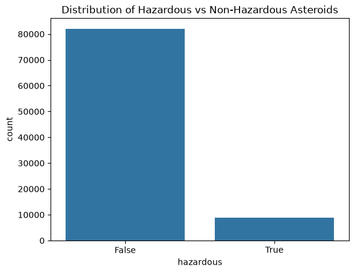
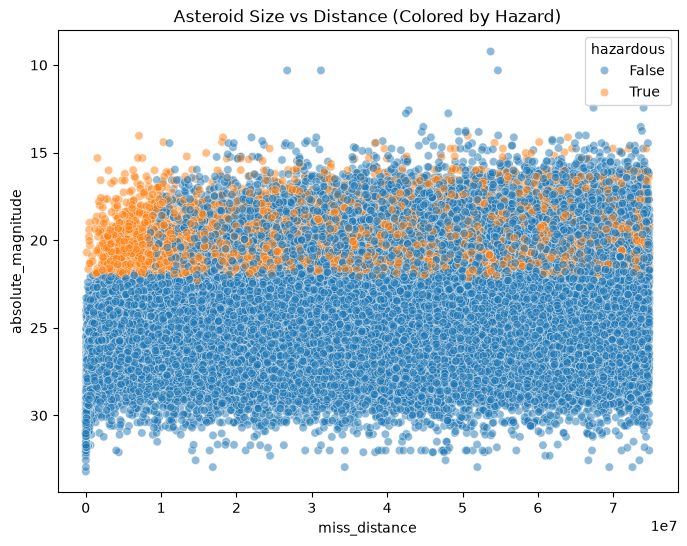
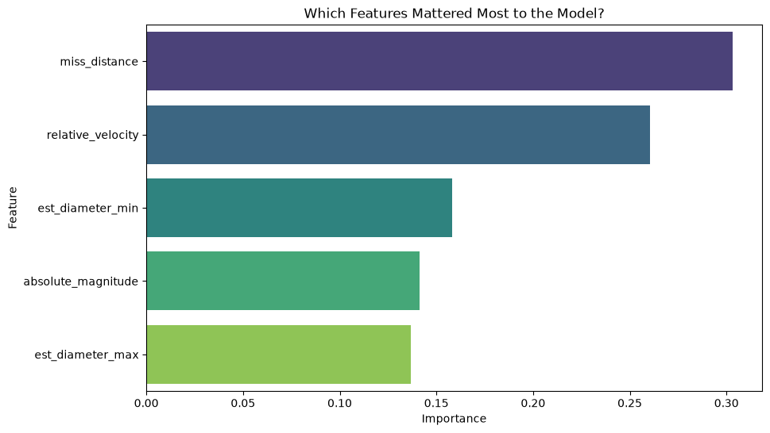
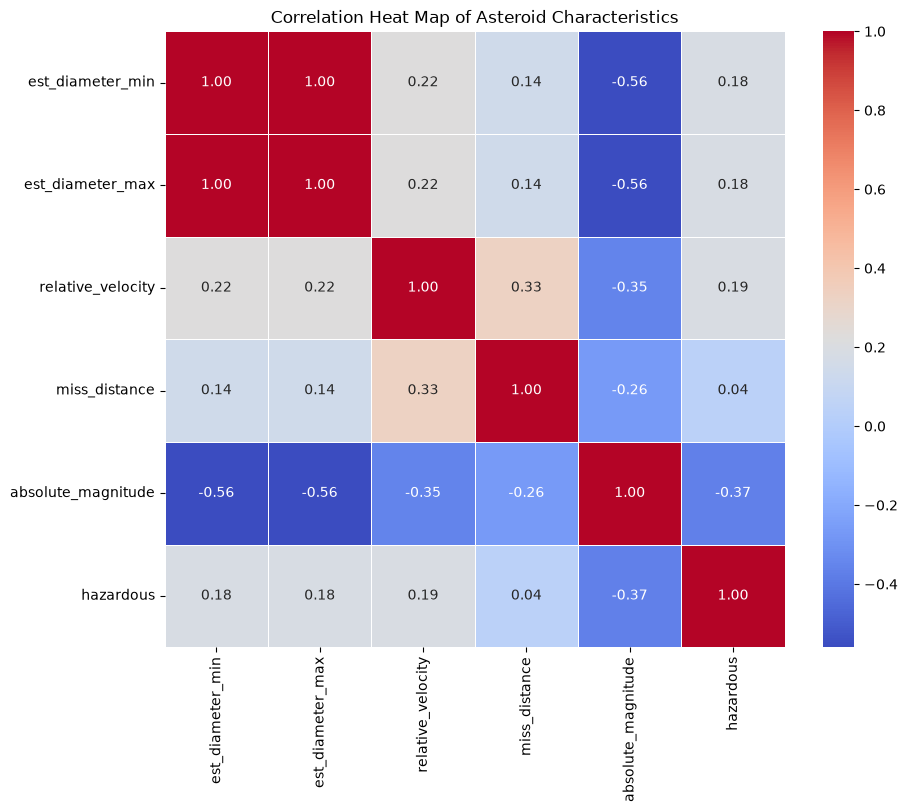

# Predicting Hazardous Near-Earth Objects

## The Problem

Can we accurately predict whether an asteroid is classified as "hazardous" based solely on its physical characteristics like size, speed, and distance from Earth?

This project investigates whether machine learning can reverse-engineer the strict, mathematical rules NASA uses to define a potentially hazardous asteroids.

## Data Source & License

- **Source:** [NASA Nearest Earth Objects Dataset on Kaggle](https://www.kaggle.com/datasets/sameepvani/nasa-nearest-earth-objects)
- **Original Creator:** NASA / Jet Propulsion Laboratory
- **License:** Public Domain / CC0 (US Government Works)

## Cleaning Log

To prepare the dataset, the following preprocessing steps were taken:

1. **Removed Identifiers:** Dropped `id` and `name` as they have no predictive power.
2. **Removed Constants:** Dropped `orbiting_body` (all are Earth) and `sentry_object` (all are False).
3. **Isolated Target Variable:** Separated the `hazardous` column into our `y` variable to prevent data leakage.
4. **Boolean Conversion:** Converted the `hazardous` column from `True/False` to `1/0` so the machine learning algorithm could process the math.
5. **Data Split:** Split the data into an 70% training set and a 30% testing set.

## Findings

The model achieved near-perfect accuracy. It didn't learn complex astrophysics, it simply learned NASA's rulebook.

### 1. The Class Imbalance


The vast majority of Near-Earth Objects are safe, meaning a model could guess "Safe" every time and still be over 90% accurate. This required looking deeper into how the model classified the rare hazardous cases.

### 2. The Hard Mathematical Cutoffs


When plotting Absolute Magnitude against Miss Distance, a sharp, distinct corner appears. NASA officially classifies an asteroid as hazardous only if it crosses within ~0.05 AU of Earth AND has an absolute magnitude of about 22.0 or less.

### 3. Feature Importance


When asking the model which features it relied on, it completely ignored relative velocity. It realized that `miss_distance` and `est_diameter` (tied directly to absolute magnitude) were the only two variables needed to classify a threat.

### 4. Correlation Heat Map (Bonus)


The correlation matrix proves mathematically what the feature importance chart suggests: hazard status is strongly correlated with size and distance, but has almost zero correlation with how fast the asteroid is moving.

## Limitations

- **Class Imbalance:** Because hazardous asteroids are so rare in the dataset, the model is highly skewed toward predicting "safe."
- **Predicting a Label, Not an Event:** This model does not predict actual Earth impacts. It simply predicts whether an asteroid meets the human-defined criteria for the label hazardous.

## How to Run

To run this analysis locally on your machine:

1. Clone this repository:
   ```bash
   git clone [https://github.com/Alexisyarbs/cs28a-final-asteroid-model.git](https://github.com/Alexisyarbs/cs28a-final-asteroid-model.git)
   ```
2. Install required python libraries

```bash
   pip install pandas scikit-learn matplotlib seaborn
```

3. Open final_project.ipnynb in jupyter notebook and run from top to bottom
